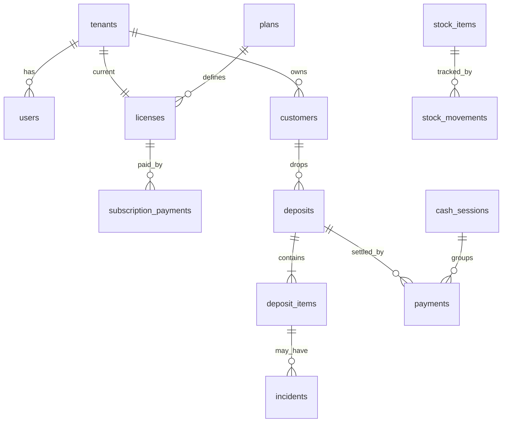

# 03 — Modèle de données

PostgreSQL via Prisma. Colonnes en `snake_case` (`@map`), modèles en `PascalCase`. Toutes les tables ont `id uuid`, `created_at`, `updated_at`. Les tables **du pressing** ont aussi `tenant_id` (indexé, premier élément des index composés). Montants : `bigint` en FCFA. Quantités de stock : `numeric(14,3)`.

## Énumérations

| Nom | Valeurs |
|---|---|
| `TenantStatus` | `ACTIVE`, `SUSPENDED`, `CLOSED` |
| `LicenseStatus` | `TRIAL`, `ACTIVE`, `GRACE`, `SUSPENDED`, `EXPIRED`, `REVOKED` |
| `PlatformRole` | `SUPER_ADMIN`, `PARTNER_VIEWER` |
| `TenantRole` | `OWNER`, `CASHIER`, `OPERATOR`, `STOCK_KEEPER`, `ACCOUNTANT`, `QUALITY`, `DRIVER` |
| `DepositStatus` | `DRAFT`, `PENDING_APPROVAL`, `OPEN`, `READY`, `PARTIALLY_RETURNED`, `COMPLETED`, `CANCELLED` |
| `ItemStatus` | `RECEIVED`, `IN_PROGRESS`, `IRONING`, `QUALITY_CHECK`, `READY`, `RETURNED` |
| `PaymentMethod` | `CASH`, `ORANGE_MONEY`, `MTN_MOMO`, `BANK_TRANSFER`, `CHEQUE` |
| `PaymentKind` | `ADVANCE`, `BALANCE`, `CREDIT_SETTLEMENT`, `REFUND` |
| `CashSessionStatus` | `OPEN`, `CLOSING_PENDING`, `CLOSED` |
| `StockMovementType` | `IN`, `OUT`, `ADJUSTMENT`, `INVENTORY` |
| `PurchaseOrderStatus` | `DRAFT`, `SENT`, `PARTIAL`, `RECEIVED`, `CLOSED` |
| `TourType` | `PICKUP`, `DELIVERY` |
| `TourStatus` | `TO_COLLECT`, `COLLECTED`, `TO_DELIVER`, `DELIVERED`, `CANCELLED` |
| `IncidentType` | `DAMAGE`, `STAIN_REMAINS`, `LOST`, `FOUND`, `REWORK` |
| `IncidentResolution` | `NONE`, `REWORK_FREE`, `COMMERCIAL_GESTURE`, `COMPENSATION` |
| `ApprovalType` | `DISCOUNT`, `STOCK_ADJUSTMENT`, `INVENTORY`, `CASH_CLOSE`, `EXPENSE`, `CREDIT` |
| `ApprovalStatus` | `PENDING`, `APPROVED`, `REJECTED` |
| `LeadStatus` | `NEW`, `CONTACTED`, `CONVERTED`, `REJECTED` |

## Plateforme (sans `tenant_id`)

| Table | Champs principaux |
|---|---|
| `tenants` | `name`, `slug` (unique), `status`, `phone`, `address`, `city`, `niu`, `rccm`, `vat_enabled`, `vat_rate`, `ticket_prefix`, `ticket_footer`, `logo_url`, `tour_days int[]` (0 = dimanche), `settings jsonb` (seuils : `discountApprovalPercent` (10), `advanceRequiredAbove` (`null` = règle désactivée), `advanceMinPercent` (50), `processingDays` (2), `expressSurchargePercent` (0), `lateAfterDays` (30), `largeExpenseAbove`, `unpaidAlertAbove`) |
| `users` | `tenant_id` nullable (null = utilisateur plateforme), `email` (unique, nullable), `phone` (unique, nullable), `password_hash`, `full_name`, `tenant_roles TenantRole[]`, `platform_role PlatformRole?`, `is_active`, `last_login_at`, `failed_logins`, `locked_until` |
| `refresh_tokens` | `user_id`, `token_hash`, `expires_at`, `revoked_at`, `user_agent` |
| `invitations` | `user_id`, `token_hash`, `expires_at`, `used_at` |
| `plans` | `code` (unique), `name`, `price_monthly_xaf`, `price_yearly_xaf`, `included_users` (défaut 2), `extra_user_price_xaf`, `trial_days`, `features jsonb`, `is_active` |
| `licenses` | `tenant_id`, `plan_id`, `key` (unique, format `LAVIO-XXXX-XXXX-XXXX`), `status`, `starts_at`, `ends_at`, `grace_days`, `max_users` (surcharge possible), `notes`. **Une seule licence courante par pressing** |
| `license_events` | `license_id`, `type` (`CREATED`, `RENEWED`, `PLAN_CHANGED`, `SUSPENDED`, `REACTIVATED`, `REVOKED`, `EXPIRED`, `GRACE_STARTED`), `payload jsonb`, `actor_id` |
| `subscription_payments` | `tenant_id`, `license_id`, `amount_xaf`, `method` (`PaymentMethod` ou `OTHER`), `reference`, `received_at`, `period_start`, `period_end`, `deductions_xaf`, `deduction_note`, `status` (`RECORDED`, `REFUNDED`), `recorded_by` |
| `leads` | `name`, `pressing_name`, `phone`, `city`, `message`, `status`, `source`, `ip_hash`, `contacted_at` |
| `platform_settings` | `key` (unique), `value jsonb` (ex. `whatsappNumber`, `shareRatePercent` = 50, `defaultTrialDays`, `defaultGraceDays`) |

## Pressing (avec `tenant_id`)

### Clients et catalogue

| Table | Champs principaux |
|---|---|
| `customers` | `name`, `phone`, `phone2`, `address`, `type` (`INDIVIDUAL`, `COMPANY`), `preferences jsonb` (`noCover`, `returnHangers`), `notes`, `credit_allowed`, `credit_limit_xaf`. Index sur `(tenant_id, phone)` et recherche par nom |
| `item_types` | `name`, `is_active` (chemise, costume, robe, couette, rideau…) |
| `services` | `name`, `is_active` (lavage, nettoyage à sec, repassage, détachage…) |
| `prices` | `item_type_id`, `service_id`, `amount_xaf`, `valid_from`, `valid_to` — historique daté, jamais de mise à jour en place |
| `special_prices` | `customer_id`, `item_type_id`, `service_id`, `amount_xaf` (clients à compte) |
| `rework_causes` | `code`, `label` (liste configurable) |

### Dépôts et suivi

| Table | Champs principaux |
|---|---|
| `deposits` | `number` (int, **unique par pressing**), `customer_id`, `status`, `received_at`, `due_date`, `express`, `subtotal_xaf`, `discount_xaf`, `total_xaf`, `paid_xaf` (calculé et mis à jour dans la même transaction que les paiements), `weight_kg?`, `notes`, `approval_id?`, `idempotency_key` (unique par pressing), `created_by` |
| `deposit_items` | `deposit_id`, `line_no`, `label_code` (ex. `000124-03`), `item_type_id`, `service_id`, `quantity`, `color`, `brand?`, `unit_price_xaf`, `care_symbols text[]`, `condition_notes`, `checklist jsonb`, `status`, `storage_location?`, `weight_kg?`, `photo_urls text[]` |
| `item_status_history` | `item_id`, `from_status`, `to_status`, `user_id`, `at` |
| `incidents` | `deposit_item_id`, `type`, `cause_id?`, `description`, `photo_urls`, `resolution`, `resolved_at?`, `created_by` |
| `return_events` | `deposit_id`, `returned_at`, `user_id`, `item_ids uuid[]` |
| `tour_requests` | `type`, `customer_id`, `address`, `tour_date`, `status`, `deposit_id?`, `amount_to_collect_xaf`, `notes` |

### Paiements, caisse, comptabilité de gestion

| Table | Champs principaux |
|---|---|
| `payments` | `deposit_id?`, `customer_id`, `amount_xaf`, `method`, `kind`, `operator_ref?` (obligatoire pour Mobile Money), `payer_phone?`, `received_at`, `cash_session_id?`, `duplicate_confirmed`, `reversal_of?` (id d'un paiement annulé), `reconciled_at?`, `reconciled_by?`, `idempotency_key`, `created_by`. **Jamais supprimé ni modifié** |
| `cash_sessions` | `opened_at`, `opened_by`, `opening_float_xaf`, `closed_at?`, `closed_by?`, `expected_cash_xaf`, `counted_cash_xaf?`, `variance_xaf?`, `status`, `note`. **Index unique partiel** : une seule session `OPEN` ou `CLOSING_PENDING` par pressing |
| `treasury_accounts` | `name`, `type` (`CASH`, `BANK`, `MOBILE_MONEY`), `opening_balance_xaf`. Le solde est calculé |
| `account_transfers` | `from_account_id`, `to_account_id`, `amount_xaf`, `at`, `note` |
| `expense_categories` | `name`, `is_active` |
| `expenses` | `category_id`, `amount_xaf`, `paid_at`, `method`, `account_id`, `supplier_id?`, `description`, `receipt_url?`, `recurring_id?`, `cash_session_id?`, `created_by` |
| `recurring_expenses` | `category_id`, `amount_xaf`, `day_of_month`, `account_id`, `next_due_on`, `is_active` |
| `supplier_invoices` | `supplier_id`, `number`, `amount_xaf`, `issued_on`, `due_on`, `paid_at?`, `purchase_order_id?` |
| `utility_readings` | `type` (`WATER`, `ELECTRICITY`), `reading_date`, `value numeric`, `note` |

### Stock et achats

| Table | Champs principaux |
|---|---|
| `suppliers` | `name`, `phone`, `address`, `payment_terms`, `notes` |
| `stock_items` | `name`, `category`, `unit`, `supplier_id?`, `purchase_price_xaf`, `avg_cost_xaf` (coût moyen pondéré), `alert_threshold`, `min_qty`, `max_qty`, `is_active` |
| `stock_movements` | `item_id`, `type`, `quantity` (signée), `unit_cost_xaf?`, `reason_code` (obligatoire pour `OUT` et `ADJUSTMENT`), `note`, `purchase_order_id?`, `inventory_id?`, `approval_id?`, `created_by`, `occurred_at`. **Le stock courant = somme des mouvements** (avec une colonne de cache `stock_items.on_hand` mise à jour dans la même transaction) |
| `purchase_orders` | `supplier_id`, `status`, `ordered_at`, `expected_at`, `notes` |
| `purchase_order_lines` | `purchase_order_id`, `item_id`, `qty_ordered`, `qty_received`, `unit_cost_xaf` |
| `inventories` | `status` (`DRAFT`, `VALIDATED`), `counted_at`, `validated_by?`, `approval_id?` |
| `inventory_lines` | `inventory_id`, `item_id`, `system_qty`, `counted_qty`, `variance_qty` |

### Transverse

| Table | Champs principaux |
|---|---|
| `approvals` | `type`, `payload jsonb`, `status`, `requested_by`, `decided_by?`, `decided_at?`, `reason?` |
| `notifications` | `user_id`, `type`, `title`, `body`, `payload jsonb`, `read_at?` |
| `push_subscriptions` | `user_id`, `endpoint` (unique), `p256dh`, `auth`, `user_agent` |
| `audit_logs` | `tenant_id?`, `user_id`, `action`, `entity`, `entity_id`, `before jsonb`, `after jsonb`, `ip`, `at`. Écriture seule, jamais modifiée |
| `counters` | `tenant_id`, `key` (ex. `deposit`), `value`. Incrément atomique (`UPDATE … RETURNING`) |

## Contraintes et index importants

- `UNIQUE (tenant_id, number)` sur `deposits` ; `UNIQUE (tenant_id, idempotency_key)` sur `deposits` et `payments`.
- Index sur `payments (tenant_id, method, operator_ref)` pour détecter les doublons Mobile Money.
- Index partiel unique sur `cash_sessions (tenant_id) WHERE status IN ('OPEN','CLOSING_PENDING')`.
- `CHECK (amount_xaf >= 0)` sur les montants ; stock négatif interdit sauf autorisation (règle de service).
- Une seule licence courante par pressing (index partiel sur `licenses (tenant_id) WHERE status IN ('TRIAL','ACTIVE','GRACE')`).
- Clés étrangères en `ON DELETE RESTRICT` : on archive (`is_active=false`), on ne supprime pas.

## Données initiales (seed)

- Plan par défaut `STANDARD` ; compte `SUPER_ADMIN` créé depuis les variables d'environnement.
- Pressing de démonstration avec jeu de données réaliste (clients, catalogue de tarifs, produits de stock, dépôts à différents statuts).
- Listes par défaut : types d'articles, services, causes de reprise, catégories de dépenses, motifs de sortie de stock.

## Diagramme (cœur métier)

